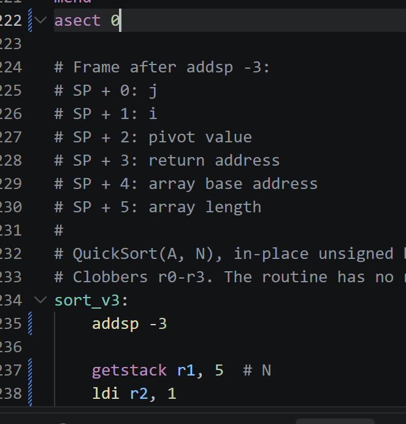
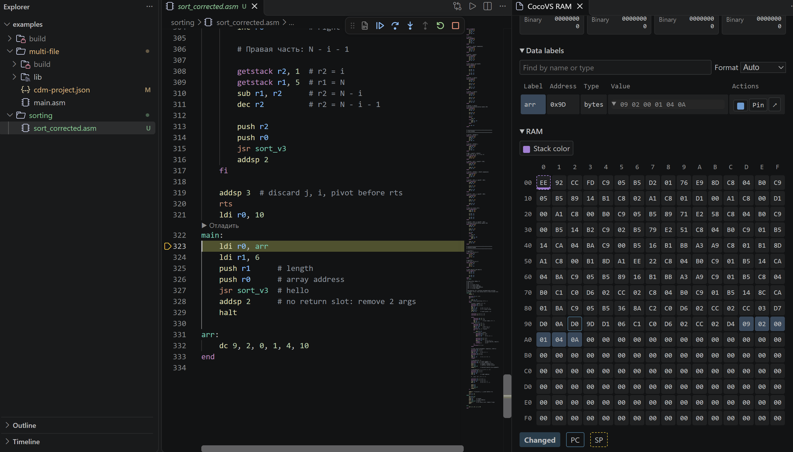

# CocoVS — CdM Assembly

CocoVS brings CdM-8 and CdM-16 (Coco-de-Mer) assembly editing, CoCAS builds, source-level debugging, and a live RAM view to Visual Studio Code. It supports single assembly files, projects with multiple source files, and custom processors.

## Features

- Complete mnemonics, operands, macros, labels, and `@include` paths. View instruction signatures and documentation as you edit.
- See inline hints for the next empty argument, and hover over binary and hexadecimal literals for their decimal values.
- Run standalone files with remembered processor and memory architecture, and start debugging from entry-point CodeLens links.
- Format assembly, jump to definitions, and click reference counts above labels and macros to see their uses. Browse call hierarchies, rename linked labels, and see CoCAS diagnostics in the **Problems** panel.
- Build and run programs through CoCAS. Use `cdm-project.json` to configure the target, memory architecture, and source files for a project.
- Step through CdM-8 and CdM-16 source, set breakpoints, and inspect registers, the stack, and RAM. Hover over a RAM byte to see its address, value, and any data labels with their types.
- Split the RAM view into movable Registers, Data Labels, and Memory Grid tabs.
- Run cdmbot test suites from the VS Code **Testing** view.
- Install cdmbot from CocoVS, analyze code statistics and syntax, create projects, and manage Git-backed assembly packages. See the [development-tool workflow](docs/cdmbot-development.md).

## Screenshots

### Assembly editor

Structured assembly formatting with distinct colors for instructions, macros, registers, labels and comments.



### Debugger and RAM inspection

Step through assembly alongside the current instruction, data labels, memory values, and colored stack and array regions. A debug link above the entry label starts the program without creating a project.



## Quick start

1. Install **CocoVS** from the VS Code Extensions view. For a downloaded package, use **Extensions: Install from VSIX...**.
2. Open or save an `.asm` file, or choose a [standalone example or project with automated tests](examples/README.md).
3. Select **CocoVS: Run** in the Command Palette, or press **F5** to debug. CocoVS can set up the required tools when prompted. Building and running require a trusted workspace.

```asm
asect 0
start:
    ldi r0, 42
    halt
end
```

On the first standalone launch, choose a processor and memory architecture; CocoVS remembers the selection per file. Use **CocoVS: Configure File Execution** to change it. `example.cdm16.asm` suggests CdM-16 by default. Standalone output goes into `build/` beside the source (for example, `sorting/build/sort.img` for `sorting/sort.asm`). Projects keep their output in the project root's `build/` directory.

### Assembly suggestions on macOS

If another extension selects a different language for `.asm` files, use **Change Language Mode** and select **CocoVS Assembly**. Press **Cmd+Shift+.** or run **CocoVS: Show Assembly Suggestions** from the Command Palette. Mnemonic completion, hover documentation, and signature help work without a toolchain. Install CoCAS to enable assembler diagnostics.

## Processor support

| Target | Run | Debug |
| --- | --- | --- |
| CdM-8 | Built-in emulator | Built-in debugger |
| CdM-8e | Project runner | CdM Processors |
| CdM-16 | Cocoemu | Built-in debugger |
| CdM-16e | Cocoemu | No built-in debugger |
| Custom processor | Project runner | Project tools |

CocoVS runs in desktop VS Code on Windows, macOS, and Linux. Automatic toolchain setup supports x64 and ARM64. See the [documentation index](docs/README.md), [user guide](docs/guide.md), [automated testing guide](docs/testing.md), and [changelog](CHANGELOG.md).

## Development

Use Node.js 22 or later.

```sh
npm ci
npm test
npm run package
```

Set `COCOVS_INTEGRATION=1` to run tests with CoCAS, cdmbot, and Cocoemu. The [development guide](docs/development.md) covers environment variables, Extension Host tests, packaging, and Marketplace updates. Documentation-only edits do not require a new VSIX.

Licensed under [MIT](LICENSE). See [third-party notices](THIRD_PARTY_NOTICES.txt).
